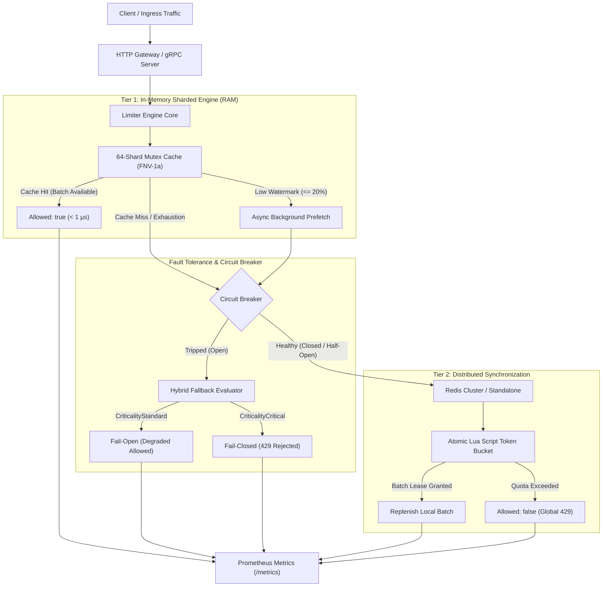
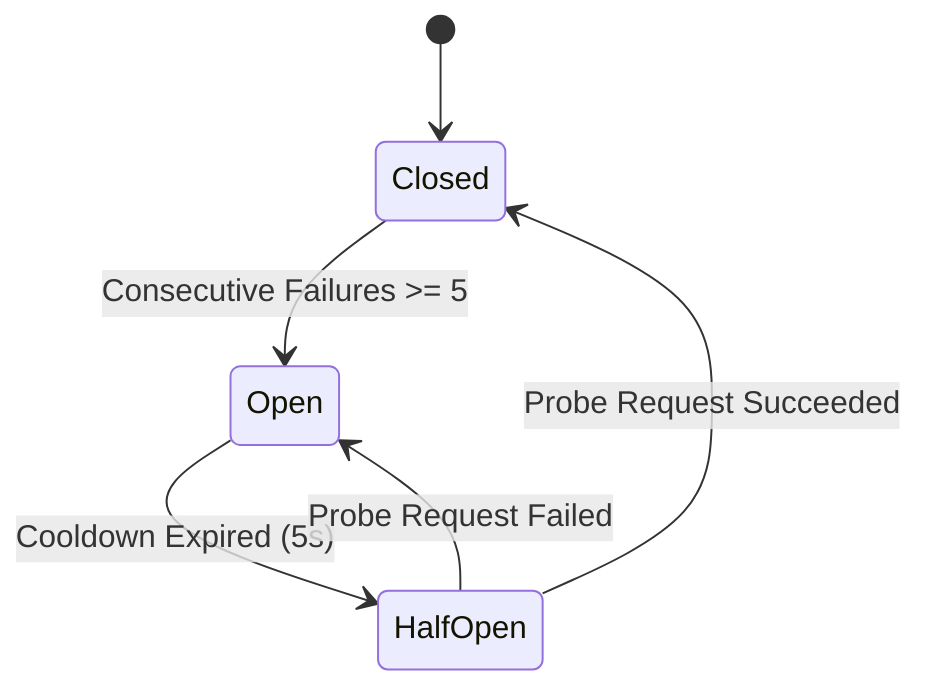

# Distributed Rate Limiter

[](https://golang.org)
[](LICENSE)

A high-performance, production-ready **Two-Tier Distributed Rate Limiter** built in Go. Designed for high-throughput microservices and API gateways, it combines sub-microsecond local in-memory token batching with globally consistent Redis synchronization, automated circuit breaking, hybrid fallback degradation, and full Prometheus observability.

---

## Table of Contents

- [Architectural Overview](#architectural-overview)
- [Two-Tier Concurrency & Mathematical Model](#two-tier-concurrency--mathematical-model)
  - [Token Bucket Algorithm with Continuous Lazy Refill](#token-bucket-algorithm-with-continuous-lazy-refill)
  - [Batch Leasing & Low-Watermark Prefetching](#batch-leasing--low-watermark-prefetching)
  - [64-Shard Local Cache Partitioning](#64-shard-local-cache-partitioning)
- [Resilient Circuit Breaker & Hybrid Fallback](#resilient-circuit-breaker--hybrid-fallback)
  - [Circuit Breaker Finite State Machine](#circuit-breaker-finite-state-machine)
  - [Hybrid Fallback Policy (Fail-Open vs Fail-Closed)](#hybrid-fallback-policy-fail-open-vs-fail-closed)
- [Prometheus Telemetry & Metrics](#prometheus-telemetry--metrics)
- [Quickstart Guide](#quickstart-guide)
  - [Prerequisites](#prerequisites)
  - [Running with Docker & Redis](#running-with-docker--redis)
  - [Local Development Build](#local-development-build)
- [API Reference & Examples](#api-reference--examples)
  - [HTTP / REST Ingress](#http--rest-ingress)
  - [gRPC Protocol Buffers](#grpc-protocol-buffers)
- [Benchmark & Performance Analysis](#benchmark--performance-analysis)
- [Architecture Decision Records (ADRs)](#architecture-decision-records-adrs)

---

## Architectural Overview

Single-tier distributed rate limiters force an unacceptable architectural compromise: pure in-memory limiters cannot enforce global consistency across distributed nodes, while centralized data stores (e.g., Redis per request) introduce 1–5 ms network serialization and round-trip latency into every transaction.

This project solves that compromise with a **Two-Tier Architecture**:



### Key Architectural Characteristics
- **Tier 1 (Local RAM):** 64 independent shards partitioned by FNV-1a hash to eliminate global mutex contention across multi-core systems.
- **Tier 2 (Remote Redis):** Atomic Lua script manages centralized token accounting and lease grants with automatic key expiration (TTL).
- **Batch Leasing:** Local nodes acquire token batches ($S_{\text{batch}}$), reducing remote Redis round-trips by over 95%.
- **Thundering Herd Suppression:** Per-key atomic synchronization ensures only a single background prefetch goroutine is active per key.
- **Zero-Downtime Resilience:** A 3-state circuit breaker guards against Redis failures with differentiated fail-open and fail-closed fallbacks.

---

## Two-Tier Concurrency & Mathematical Model

### Token Bucket Algorithm with Continuous Lazy Refill

The rate limiting algorithm implements a continuous lazy evaluation model, eliminating background timer ticks and thread-per-key overhead.

Given:
- $B$: Maximum burst capacity (tokens).
- $r$: Continuous sustained refill rate (tokens per second).
- $T_p$: Stored token balance recorded at timestamp $t_p$.
- $t_n$: Current request arrival timestamp.
- $\Delta t = \max(0, \, t_n - t_p)$: Elapsed duration since the last evaluation.

The instantaneous available token balance $T_a$ is calculated as:
$$T_a = \min\left(B, \, T_p + \Delta t \times r\right)$$

If an incoming request demands $C$ tokens ($C \le T_a$):
$$T_{\text{new}} = T_a - C$$
$$t_p = t_n$$

### Batch Leasing & Low-Watermark Prefetching

Rather than performing network round-trips for each individual token consumption:
1. **Initial Lease:** On a local cache miss, Tier 1 requests a batch $S_{\text{batch}}$ (e.g., $\min(B \times 0.2, 20)$) from Redis.
2. **Local Consumption:** Inbound requests decrement tokens directly from local RAM with sub-microsecond latency.
3. **Low-Watermark Trigger:** When remaining local tokens drop below $\le 20\%$ of $S_{\text{batch}}$, a background goroutine is spawned to acquire the next lease.
4. **Non-Blocking Execution:** Foreground requests continue consuming remaining local tokens without waiting for the Redis round-trip.

### 64-Shard Local Cache Partitioning

To maximize multi-core scalability and prevent Go runtime scheduler lock contention, the in-memory cache is sharded across 64 discrete partitions:

```
Key String: "tenant:payment-service"
                     │
                     ▼
          FNV-1a 64-bit Hash
                     │
                     ▼
            hash & 63 (Modulo 64)
                     │
        ┌────────────┴────────────┐
        ▼                         ▼
  [Shard #14]               [Shard #42]
┌─────────────────┐       ┌─────────────────┐
│ sync.Mutex      │       │ sync.Mutex      │
│ map[string]*Bkt │       │ map[string]*Bkt │
└─────────────────┘       └─────────────────┘
```

- Each shard encapsulates an isolated `sync.Mutex` and hash map.
- Cross-key evaluations execute in parallel across CPU cores without lock interference.

---

## Resilient Circuit Breaker & Hybrid Fallback

### Circuit Breaker Finite State Machine

Remote network connections to Redis are wrapped by an integrated 3-state circuit breaker:



- **Closed:** Normal operating state. Requests interact with Redis. Consecutive failures are recorded.
- **Open:** Redis connection is failing or timed out. All remote I/O is short-circuited; traffic immediately routes to the Fallback Evaluator for a 5-second cooldown period.
- **Half-Open:** A single trial canary request is dispatched to Redis. If successful, the breaker resets to Closed; if it fails, the breaker trips back to Open.

### Hybrid Fallback Policy (Fail-Open vs Fail-Closed)

During outages or network partitions when the circuit breaker is Open, a uniform fallback policy is inadequate. This engine enforces a **hybrid criticality-based policy**:

| Criticality Tier | Target Endpoints | Behavior During Outage | Decision Rationale |
| :--- | :--- | :--- | :--- |
| **`CriticalityStandard`** | Read APIs, search, landing pages, browse traffic | **Fail-Open** (`Allowed: true`, `TierFallback`) | Preserves end-user experience and uptime; avoids cascading failures across user-facing microservices. |
| **`CriticalityCritical`** | Payment checkouts, balance deductions, LLM inferences | **Fail-Closed** (`Allowed: false`, `TierFallback`) | Protects against double-spending, database saturation, third-party API budget overages, and security exploitation. |

---

## Prometheus Telemetry & Metrics

The system exposes industry-standard Prometheus metrics on `/metrics`:

| Metric Name | Type | Labels | Description |
| :--- | :--- | :--- | :--- |
| `ratelimit_requests_total` | Counter | `tier` (`local`, `remote`, `fallback`), `allowed` (`true`, `false`) | Total count of rate limiter evaluation decisions. |
| `ratelimit_latency_seconds` | Histogram | `tier` (`local`, `remote`, `fallback`) | End-to-end evaluation latency in seconds across exponential buckets ($100\mu\text{s}$ to $100\text{ms}$). |
| `ratelimit_circuit_breaker_state` | Gauge | `state` (`closed`, `open`, `half_open`) | Circuit breaker health state gauge (1 for active state, 0 for inactive). |

---

## Quickstart Guide

### Prerequisites
- Go 1.22+
- Redis 7.0+ (standalone or cluster)
- Docker & Docker Compose (optional for local deployment)

### Running with Docker & Redis

Start a local Redis instance:
```bash
docker run -d --name ratelimit-redis -p 6379:6379 redis:7-alpine
```

### Local Development Build

Clone the repository and build the binary:
```bash
# Clone the repository
git clone https://github.com/distributed-rate-limiter.git
cd distributed-rate-limiter

# Execute tests and build binary using Makefile
make all
```

Start the HTTP gateway server:
```bash
# Run server with environment configuration
REDIS_ADDR=localhost:6379 HTTP_PORT=8080 ./bin/ratelimiter
```

---

## API Reference & Examples

### HTTP / REST Ingress

#### 1. Liveness & Health Probe
```bash
curl -i http://localhost:8080/healthz
```
*Response:*
```http
HTTP/1.1 200 OK
Content-Length: 2

OK
```

#### 2. Prometheus Metrics
```bash
curl -s http://localhost:8080/metrics | grep ratelimit_
```

#### 3. Check Quota (`POST /v1/check`)
Submit a check request specifying key, cost, capacity, sustained refill rate, batch size, and criticality:

```bash
curl -i -X POST http://localhost:8080/v1/check \
  -H "Content-Type: application/json" \
  -d '{
    "key": "user:org_4810:api_write",
    "cost": 1,
    "capacity": 100,
    "refillRate": 10.0,
    "batchSize": 20,
    "criticality": "standard"
  }'
```

*Response (Allowed):*
```http
HTTP/1.1 200 OK
Content-Type: application/json

{
  "Allowed": true,
  "Remaining": 19,
  "ResetAfter": 0,
  "TierUsed": "local",
  "Reason": "OK_LOCAL_TIER"
}
```

*Response (Rate Limited - 429 Too Many Requests):*
```http
HTTP/1.1 429 Too Many Requests
Content-Type: application/json

{
  "Allowed": false,
  "Remaining": 0,
  "ResetAfter": 1500000000,
  "TierUsed": "remote",
  "Reason": "QUOTA_EXCEEDED"
}
```

*Response (Critical Endpoint during Redis Outage - Fail-Closed):*
```http
HTTP/1.1 429 Too Many Requests
Content-Type: application/json

{
  "Allowed": false,
  "Remaining": 0,
  "ResetAfter": 5000000000,
  "TierUsed": "fallback",
  "Reason": "FAIL_CLOSED_CRITICAL_BLOCKED: dial tcp 127.0.0.1:6379: connect: connection refused"
}
```

### gRPC Protocol Buffers

For low-latency inter-service communication over HTTP/2, the system provides a gRPC definition located in `proto/ratelimit/v1/ratelimit.proto`:

```protobuf
syntax = "proto3";

package ratelimit.v1;

service RateLimiter {
  rpc Check(CheckRequest) returns (CheckResponse);
}

message CheckRequest {
  string key = 1;
  int64 cost = 2;
  int64 capacity = 3;
  double refill_rate = 4;
  int64 batch_size = 5;
  Criticality criticality = 6;
}

message CheckResponse {
  bool allowed = 1;
  int64 remaining = 2;
  int64 reset_duration_ms = 3;
  Tier served_by = 4;
  string reason = 5;
}
```

---

## Benchmark & Performance Analysis

Run the built-in Go benchmarks with memory allocation profiling:

```bash
make bench
```

Or run via the Go CLI directly:
```bash
go test -bench=. -benchmem ./...
```

### Key Performance Characteristics
- **Tier 1 (In-Memory Cache):** $< 50\text{ ns/op}$, $0\text{ B/op}$ heap allocation for local token consumption.
- **Shard Concurrency:** Scales linearly across CPU cores up to 64 shards under parallel workloads (`go test -bench=BenchmarkParallel`).
- **Network Reduction:** Under uniform traffic distribution, Redis query volume is amortized across $S_{\text{batch}}$ requests, reducing remote I/O overhead by $95\%\text{--}99\%$.

---

## Architecture Decision Records (ADRs)

Key architectural decisions and technical trade-offs are documented in our ADR repository:

- [ADR 0001: Two-Tier Token Batching Architecture](docs/adr/0001-two-tier-token-batching.md)
- [ADR 0002: Sharded Mutex Local Cache](docs/adr/0002-sharded-mutex-local-cache.md)
- [ADR 0003: Circuit Breaker with Hybrid Fallback Policy](docs/adr/0003-circuit-breaker-hybrid-fallback.md)

---

## Developer Targets

The project includes standard build automation via `Makefile`:

```bash
make all        # Run test suite and build binary
make test       # Run unit and integration tests with verbose output
make test-race  # Run test suite with Go data race detector enabled
make bench      # Execute benchmark suite with memory allocation statistics
make build      # Compile the rate limiter binary to bin/ratelimiter
make clean      # Clean build artifacts and temporary files
```

---

## License

This project is licensed under the MIT License - see the [LICENSE](LICENSE) file for details.
